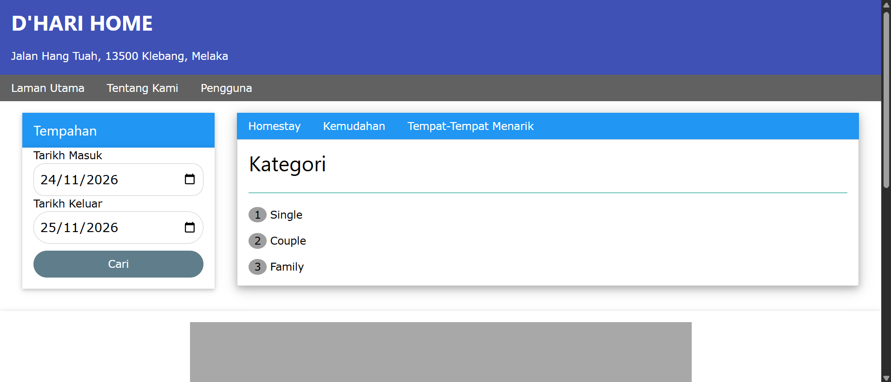
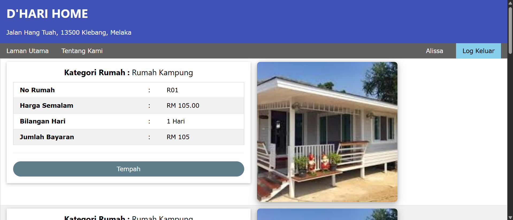
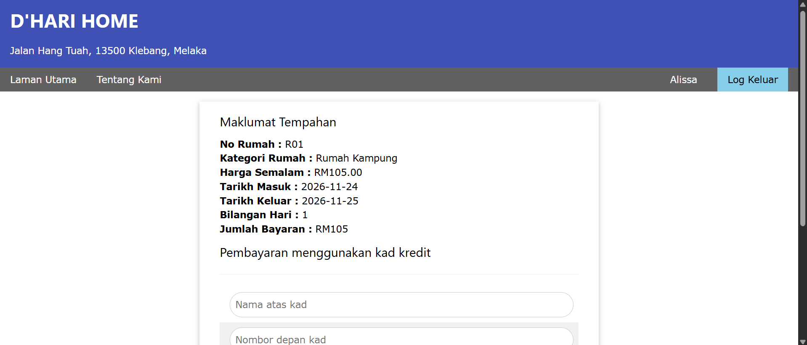
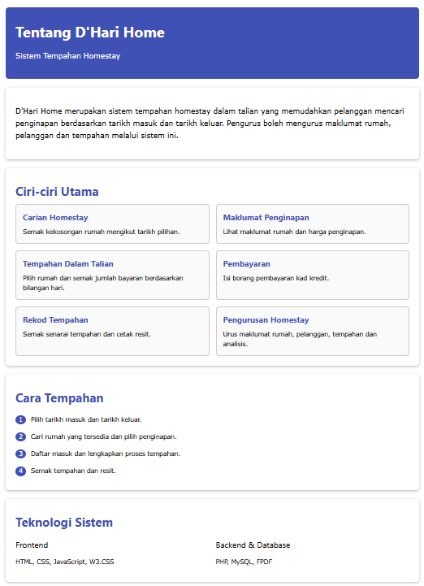
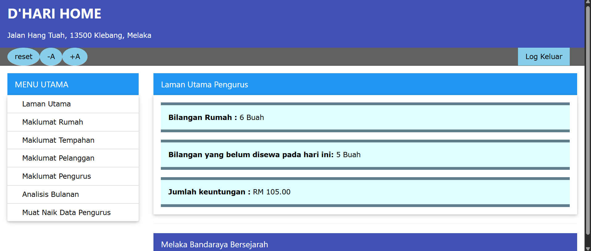
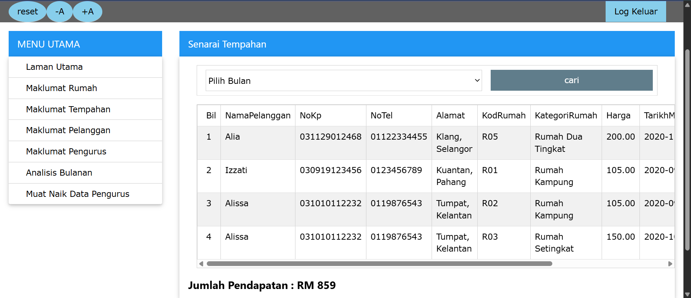

# D'Hari Home – Web-Based Homestay Booking System

## Project Overview

D'Hari Home is a web-based homestay booking system originally developed in 2020 as part of my SPM Computer Science coursework.

The system was designed to digitize the traditional homestay reservation process by providing an online platform for customers to search for available accommodation, make reservations, complete simulated payments, and generate booking receipts.

The system also provides a separate administrator interface for managing homestays, customer information, reservations, administrator accounts, and monthly income analysis.

This project represents one of my earliest experiences in full-stack web development, where I learned to integrate frontend interfaces, backend functionality, and relational databases.

The project was restored and redeployed in 2026 for portfolio and demonstration purposes to showcase the early stages of my programming journey.

The website interface is presented in Bahasa Melayu.

## Live Demo

**Website:** [Visit D'Hari Home](http://dharihome.site.je)

> **Note:** This website is hosted on InfinityFree for portfolio and demonstration purposes. The live demo may become temporarily or permanently unavailable in the future due to hosting limitations or changes. The project source code remains available in this repository.

## Demo Account

Visitors can use the following demo account or register a new account to explore the system.

| Role | Login ID | Password |
| --- | --- | --- |
| Customer | alissa | alissa123 |
| Administrator | 080808122222 | 1234 |

> Please use dummy information when testing the reservation and payment features. Do not enter real credit card details.

## Project Objectives

- Digitize the traditional homestay reservation process.
- Allow customers to search for available accommodation based on selected dates.
- Reduce conflicting reservations through database-driven availability checking.
- Provide customers with convenient access to their booking records.
- Apply full-stack web development concepts to an accommodation booking scenario.

## Key Features

### Customer Module

#### Account Management

- Customer registration
- Customer login and logout
- Session-based authentication
- Customer account identification

#### Homestay Search and Reservation

- Search homestays based on check-in and check-out dates
- Check accommodation availability
- Browse accommodation categories
- View homestay information and images
- Select available accommodation
- Submit homestay reservations

#### Payment and Receipt

- Review reservation and payment details
- Simulated credit card payment
- Record reservations in the database
- Generate booking receipts
- Print or save receipts in PDF format

#### Booking History

- View previous reservations
- Access personal booking records
- Review reservation details

#### Additional Information

- Browse homestay categories
- View nearby public facilities
- Explore tourist attractions in Melaka

### Administrator Module

#### Administrator Account Management

- Separate administrator login interface
- View administrator account information
- Register administrator accounts
- Update administrator information
- Administrator logout

#### Homestay Management

- View registered homestays
- Add new homestays
- Assign accommodation categories
- Upload homestay images
- Remove homestay records

#### Customer Management

- View registered customers
- Access customer information

#### Reservation Management

- View customer reservation records
- Review homestay booking information
- Monitor recorded reservations

#### Income Analysis

- Filter reservation records by month
- Calculate total monthly income
- Display monthly income summaries

## System Workflow

### Customer Workflow

1. Customer visits the main website.
2. Customer selects the preferred check-in and check-out dates.
3. The system retrieves available homestays from the database.
4. Customer selects the preferred accommodation.
5. Customer registers or logs in to an existing account.
6. Customer reviews the reservation details.
7. Customer completes the simulated payment process.
8. The reservation is recorded in the database.
9. The system generates a booking receipt.
10. Customer can access previous reservations through the booking history page.

### Administrator Workflow

1. Administrator accesses the separate administrator login page.
2. Administrator logs in using registered credentials.
3. The system displays the administrator interface.
4. Administrator accesses the available management modules.
5. Administrator manages homestay and administrator records.
6. Administrator reviews customer and reservation information.
7. Administrator views monthly income analysis.

## Technology Stack

| Technology | Purpose |
| --- | --- |
| PHP | Server-side development and business logic |
| MySQL | Database management and reservation storage |
| HTML5 | Website structure |
| CSS3 | Interface styling and layout |
| JavaScript | Client-side functionality |
| W3.CSS | Responsive interface styling |
| FPDF | PDF receipt generation |

## Database Structure

The system uses a relational database to manage customer accounts, administrator accounts, accommodation details, categories, and reservation records.

| Table | Purpose |
| --- | --- |
| pelanggan | Stores customer account information |
| pengurus | Stores administrator account information |
| rumah | Stores homestay information |
| kategori | Stores accommodation categories |
| tempahan | Stores customer reservation records |

The database connects customer accounts, accommodation information, and reservation records to support the booking process and administrative management.

## Technical Skills Demonstrated

- Full-stack web application development
- Frontend and backend integration
- PHP and MySQL development
- Relational database design
- SQL queries and table relationships
- CRUD operations
- User authentication and session management
- Customer and administrator role separation
- Date-based availability checking
- Reservation management
- Form handling and data processing
- Image upload functionality
- PDF document generation
- Monthly income calculation
- Responsive web interface development
- Website hosting and deployment
- Debugging and troubleshooting

## System Screenshots

### Customer Interface

#### Homepage

#### Homestay Availability

#### Reservation Details

#### About

### Administrator Interface

#### Administrator Homepage

#### Monthly Income Analysis

## Demo Video

[Watch System Demonstration](https://youtu.be/FFmQ1d7KrEs) 

## Local Installation

To run this project on your local machine:

1. Download or clone this repository.
2. Install XAMPP or another PHP and MySQL development environment.
3. Place the project folder inside the `htdocs` directory.
4. Start Apache and MySQL.
5. Create a database using phpMyAdmin.
6. Import the SQL database file, if provided.
7. Configure the database connection in `connection.php`.
8. Open the project through your browser.

### Customer Portal

    http://localhost/tempahan_homestay/

### Administrator Portal

    http://localhost/tempahan_homestay/pengurus/

## Known Limitations

This project was originally developed in 2020 during my secondary school education and was later restored and redeployed in 2026.

As this was one of my earliest web development projects, the system uses traditional PHP development practices and does not fully implement modern software architecture or security standards.

The original interface and core functionality have been preserved to reflect my programming knowledge and experience at the time of development.

The payment feature is a simulation and does not integrate with an actual payment gateway.

The system is intended for educational and portfolio demonstration purposes and is not recommended for production use without further security improvements and testing.

## Future Improvements

- Implement secure password hashing
- Implement prepared statements to prevent SQL injection
- Improve input validation and error handling
- Strengthen administrator authentication and access control
- Integrate a secure online payment gateway
- Implement reservation cancellation and modification
- Introduce automated booking confirmation emails
- Develop an interactive accommodation availability calendar
- Enhance income analysis with charts and annual reports
- Improve mobile responsiveness
- Modernize the user interface
- Refactor the codebase using modern development practices
- Implement automated database backups

## Project Information

- **Project Name:** D'Hari Home
- **Project Type:** SPM Computer Science Coursework
- **Year:** 2020
- **Category:** Full-Stack Web Development
- **Interface Language:** Malay
- **Development Scope:** Frontend, Backend and Database

## Developer

This project was originally developed during my secondary school education in 2020 as part of my SPM Computer Science coursework.

It represents an early milestone in my programming journey and reflects how my interest in web application development began before pursuing higher education.

Through this project, I gained foundational experience in programming, database management, user authentication, reservation logic, and frontend and backend integration.

In 2026, I restored and redeployed this project as part of my software development portfolio.

Rather than completely rebuilding the system using modern technologies, I chose to preserve its original design and functionality to document my growth and progress as a developer over the years.

Thank you for taking the time to explore this project!
